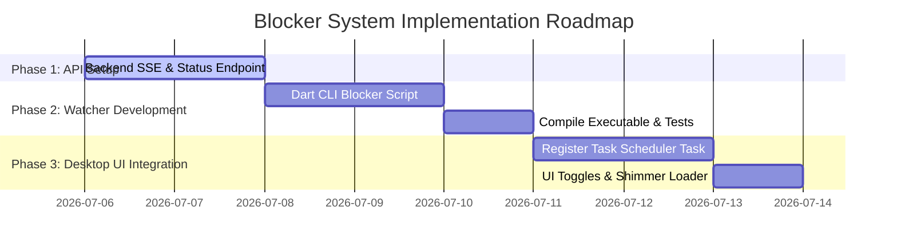

# Dynamic Process Blocker Implementation Plan

This plan outlines the steps required to implement the dynamic, SSE-driven background process blocker for your desktop application, including behavior when the UI app is closed.

---

## 📅 Roadmap Overview



---

## 🔒 Behavior When the UI Application is Closed

To ensure zero bypass, the system must handle all scenarios when the user closes the desktop application:

1. **Detached Background Daemon (`binance_watcher.exe`)**:
   - The watcher executable runs as a separate process without any GUI.
   - Closing the Flutter UI has **no effect** on this process. It remains active in memory.
2. **Persistent SSE connection**:
   - The watcher holds a continuous backend stream socket connection.
   - If the backend flags the lockout, the watcher receives the event and immediately kills target processes.
3. **SSE Auto-Reconnection & Last-Event-ID**:
   - SSE has an in-built auto-reconnection feature. If the connection drops, `binance_watcher.exe` immediately attempts to reconnect to the server.
   - **Last-Event-ID**: Each SSE message sent by the server will include a unique message ID. Upon reconnecting, the watcher will transmit the last received ID via the `Last-Event-ID` header. The backend server reads this header to detect missed lockout events that occurred while the client was briefly disconnected, pushing them down the stream immediately.
4. **Offline Mode (No Internet or Server Down)**:
   - The watcher continually monitors a saved local expiry timestamp (`lockedUntil`).
   - If the user disconnects the internet, the watcher continues to forcefully block the apps locally until the PC system time exceeds the `lockedUntil` timestamp.
5. **Resiliency to Reboots (Windows Task Scheduler)**:
   - If the PC is restarted, Windows automatically relaunches the watcher on login (`ONLOGON`) using highest privileges, reading the local state file to resume blocking before the user can open any trading platforms.

---

## 🛠️ Step-by-Step Action Items

### Phase 1: API / Backend Integration
- [ ] Define the response structure for the `/trades/sync` or status API to include:
  - `locked` (bool)
  - `lockedUntil` (ISO Timestamp)
  - `appsToBlock` (List of Strings, e.g. `["Binance.exe", "thinkorswim.exe"]`)
- [ ] Set up the SSE stream to emit status updates in real-time when the daily limit is breached.

### Phase 2: Detached Watcher Development (`binance_watcher.exe`)
- [ ] Create/update the background Dart CLI script (`tools/binance_watcher.dart`):
  - Add native HTTP Client to connect to the SSE stream.
  - Implement a persistent socket listener parsing incoming JSON lockout events.
  - Implement fallback polling (e.g. every 30 seconds) if SSE drops.
  - Implement offline expiry check using the locally saved `lockedUntil` timestamp.
  - Implement the dynamic process kiler looping through the parsed `appsToBlock` array.
- [ ] Compile the script to a Windows native executable:
  ```bash
  dart compile exe tools/binance_watcher.dart -o build/binance_watcher.exe
  ```

### Phase 3: Desktop App Integration (`BinanceBlockerService`)
- [ ] Update [binance_blocker_service.dart](file:///C:/Users/rosde/All%20Project/TradeLMT/lib/core/Binace/binance_blocker_service.dart) to:
  - Copy `binance_watcher.exe` to the local application runtime folder.
  - Register the task using `schtasks` with `/SC ONLOGON` and `/RL HIGHEST` dynamically.
  - Write state and settings (`appsToBlock`, `lockedUntil`) into the local temp files.

### Phase 4: UI & SSE Wireup in Flutter
- [ ] Listen to the SSE stream on the dashboard.
- [ ] When the lock trigger is received, call `BinanceBlockerService().enableBlock()` to invoke the background watcher.
- [ ] When the unlock event is received (or lockout timer expires), call `disableBlock()`.
